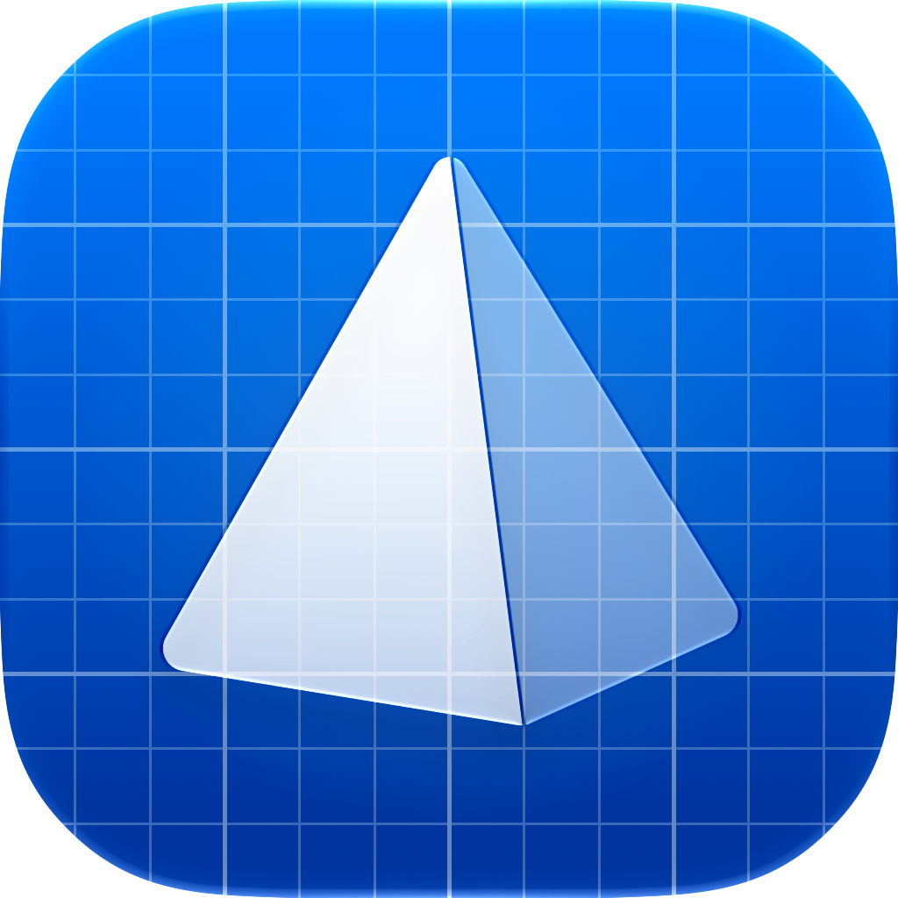

### delt
An experiment in multi-agent software development, using a corporate hierarchy of agents to coordinate work with assigned roles!
- Give a task to Agent Delta, your Chief of Staff, and watch a team of directors, supervisors, and analysts form beneath it!
- See agents work through structured system calls like Recruit, Order, and Report instead of chatting with you directly!
- Stay in control with an approval chain: sensitive calls need a sign-off from every superior, and sometimes from you!
- Approve the plan before anything runs: commands only execute after the move from Planning to Execution!

